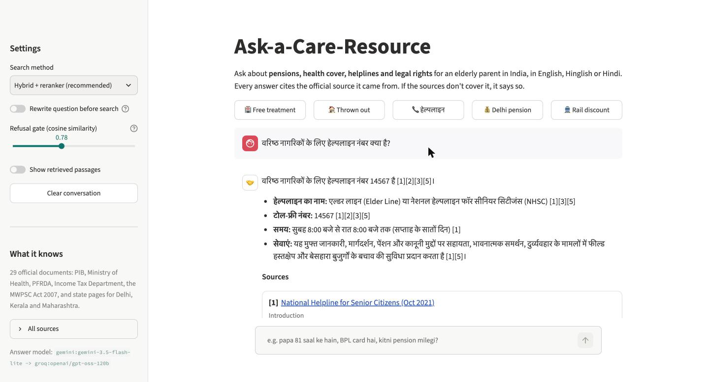

# Ask-a-Care-Resource

A retrieval-augmented assistant for families in India who are caring for an elderly parent. It
answers questions about **government schemes, pensions, health cover, helplines and legal rights
for senior citizens**, in English, Hinglish or Hindi. It **cites the passages it used**, and it
says *"I don't know from these sources."* when the corpus does not contain the answer. An honest
evaluation is included, with all of its weak spots.



**Headline numbers** (43 hand-written questions, default configuration):
- **Retrieval:** hit@5 1.00, MRR 0.98.
- **Refusals:** 9 of 9 unanswerable questions refused, with 0 false refusals.
- **Answer quality:** key-fact recall 0.95, judge-rated citation correctness 0.92.
- **Fabricated numbers:** 2 answers contained an invented amount ("₹7 lakh"). A deterministic
  number check caught both; the LLM judge missed one of them.

All the numbers are in [Results](#results).

---

## Run it

Requirements: Python 3.11 and [uv](https://docs.astral.sh/uv/). It was tested on an M2 MacBook
Air with 8 GB and runs on CPU too. You need one LLM key: a free Gemini key from
<https://aistudio.google.com/apikey> and/or a free Groq key from <https://console.groq.com/keys>.
Alternatively, run [Ollama](https://ollama.com) locally.

```bash
make setup     # venv + install; creates .env from .env.example -> put your key(s) in .env
make all       # ingest (clean -> chunk -> embed -> index) + full evaluation -> results/RESULTS.md
```

Then:

```bash
make app       # Streamlit UI      http://localhost:8501   (shareable: /?q=your+question)
make api       # FastAPI           http://localhost:8000/docs   POST /ask {"question": "..."}
python -m care_rag.cli ask "papa 81 saal ke hain, BPL card hai, kitni pension milegi?"
python -m care_rag.cli bench   # uncached end-to-end latency on 10 questions
make test      # 30 unit tests, no network or keys needed
```

Notes:
- **Ingestion and the retrieval evaluation need no API key.** `python -m care_rag.cli eval
  --retrieval-only` runs offline once the embedding models are downloaded.
- **The raw corpus snapshot is committed** in `data/raw/`, with a SHA-256 manifest. Several
  government sites were down or flaky while this was built, and the snapshot keeps runs
  reproducible. `python -m care_rag.cli ingest --refresh` re-downloads everything.
- **LLM responses are cached** in `.cache/llm_cache.sqlite` (gitignored), keyed by provider,
  model and prompt, together with the original call's latency. Re-running the evaluation is free,
  deterministic, and safe against free-tier quotas.
- **Keys live only in `.env`, which is gitignored.** They are never logged or cached, and account
  identifiers are redacted from any error text saved in `results/`.

## How it works

```
sources.yaml ─▶ fetch ─▶ data/raw/  (committed snapshot + sha256 manifest)
                            │
                            ▼
   clean   HTML → markdown (trafilatura) · PDF → markdown (pymupdf4llm, plain-text fallback)
           → sections by heading · repair PDF word splits ("for m aintenance") · drop boilerplate
                            │
                            ▼
   chunk   per section, ~300 words, 50-word sentence-aligned overlap
           metadata: source id · title · section · url · language · category
                 ┌──────────┴──────────┐
                 ▼                     ▼
       multilingual-e5-base       BM25 (rank_bm25)
       FAISS, exact cosine             │
                 └──────────┬──────────┘
                            ▼
   fuse    Reciprocal Rank Fusion (k = 60) → top 20
   rerank  multilingual cross-encoder (mMiniLM-L12) → top 5 passages
                            ▼
   gate    best cosine < 0.78 → "I don't know from these sources."   (no LLM call)
                            ▼
   answer  Gemini → Groq → Ollama fallback · numbered passages · strict prompt
                            ▼
   verify  every [n] must point at a shown passage · every number must appear in a passage
```

| File (`src/care_rag/`) | Responsibility |
|---|---|
| `fetch.py` | Polite fetching with retries and verified TLS; writes the raw snapshot and manifest |
| `clean.py` | HTML/PDF → markdown → sections; corpus-statistics repair of PDF kerning splits |
| `chunk.py` | Section-bounded chunking with sentence-aligned overlap |
| `embed.py`, `index.py` | e5 embeddings (`query:`/`passage:` prefixes), FAISS and BM25 indexes, one per chunk size |
| `retrieve.py` | Dense, BM25, RRF fusion, optional cross-encoder rerank (fp16 on GPU/MPS) |
| `llm.py` | Gemini / Groq / Ollama behind one interface: fallback, retry hints, timeouts, SQLite cache |
| `prompts.py` | Every prompt in one reviewable file |
| `answer.py` | Rewrite (optional) → retrieve → gate → generate → citation and number checks |
| `evaluate.py`, `report.py` | Metrics, LLM judge, judge check, gate calibration, `results/RESULTS.md` |
| `cli.py`, `../app.py`, `../api.py` | CLI, Streamlit UI, FastAPI |

## Corpus

There are 29 official documents, about 42,500 words after cleaning. Full list with URLs:
[`sources.yaml`](sources.yaml). They cover:
- central schemes (PIB releases and backgrounders, the PM-JAY 70+ guidelines, DGHS, PFRDA, the
  Income Tax Department, SBI for SCSS);
- the **full text of the Maintenance and Welfare of Parents and Senior Citizens Act, 2007**;
- state pensions for **Delhi, Kerala and Maharashtra**;
- the **Hindi** edition of PIB's *Elderly in India 2025*.

Deliberately left out:
- **myScheme.gov.in**: pages are rendered client-side, and the data sits behind an API key
  embedded in their frontend. I did not use that key.
- **India Code, nha.gov.in, socialjustice.gov.in, nsap.nic.in**: these were down or timing out
  during the build; PIB copies carry the same facts.
- **Sites failing TLS certificate verification**: I did not disable verification to get them.

## Design choices

**Chunking.** Each document is first split into its own sections: HTML headings, PDF headings,
and the numbered sections of the Act. Inside a section I pack whole paragraphs and sentences up
to about 300 words, with about 50 words of sentence-aligned overlap. A chunk never crosses a
section boundary. Government documents are lists of separate schemes and clauses, and mixing two
schemes in one chunk is how a RAG system ends up quoting the right number for the wrong scheme.
The overlap keeps a fact that falls across a boundary retrievable. The embedded text is prefixed
with `title | section`, so a short chunk like "Rs 2500 p.m. for +70 beneficiaries" still carries
"Delhi old age assistance" with it.

**Retrieval.** Each component was measured rather than assumed:
- *Dense retrieval* (multilingual-e5) handles paraphrase, Hindi and Hinglish.
- *BM25* handles exact tokens such as "80TTB" and "14567".
- *RRF* fuses the two rankings without calibrating their scores against each other.
- *A small multilingual cross-encoder* re-orders the top 20.

**Refusal has two layers.**
1. A cheap **similarity gate**: if no passage is even close to the question, refuse without
   calling the LLM.
2. A **strict prompt**: the model must reply with the exact refusal sentence when the passages
   do not answer the question, and must not answer a nearby question instead.

The gate is calibrated on the eval set. The highest threshold that refuses no answerable
question is 0.79, and it is set to 0.78 for a margin. A wrong refusal costs a family more than
an extra LLM call.

**Answers are verified mechanically, not just prompted.**
- Every `[n]` must refer to a passage that was shown.
- Every **number** in the answer (amounts, ages, limits, phone numbers) must appear in the
  passages or in the user's own question. The check also matches numbers the source spells out,
  such as "ninety days".
- Unverified numbers are shown to the user as a warning. A fabricated "₹7 lakh" reads exactly as
  convincingly as a real "₹5 lakh", and a family acts on that number.

**A different model family judges.**
- Answers come from Gemini; the judge is Groq's `gpt-oss-120b`.
- When Groq is rate-limited, the judge waits (using Groq's own "try again in N s" hint) rather
  than falling back to Gemini grading Gemini's own answers.
- Any remaining self-judged answers are counted in the results.
- Temperature is 0 everywhere.

**Dates matter.** Amounts and schemes change; PMVVY, for example, closed on 31 March 2023. The
prompt asks the model to give the date the source gives for any amount, and the eval contains a
trap question on PMVVY.

**Running on a laptop.**
- The reranker loads in fp16, and only one cross-encoder is held in memory at a time. In fp32
  the large reranker pushed an 8 GB Mac into swap, at 10–30 s per query.
- Models load from the local Hugging Face cache before trying the network. A hung "check for
  updates" request once stalled a whole evaluation run.

## Evaluation

[`eval/eval_set.yaml`](eval/eval_set.yaml) contains **43 hand-written questions**:

| Group | Count |
|---|---|
| Formal, single source | 21 |
| Formal, multi-source (needs two documents) | 2 |
| Stressed / informal English | 4 |
| Hinglish | 5 |
| Hindi (Devanagari) | 2 |
| **Unanswerable** | **9** (5 formal, 2 stressed, 1 Hinglish, 1 Hindi) |

The unanswerable questions are chosen to be *tempting*: each one touches something the corpus
does mention, without containing the answer.
- A railway station appears in a story, but there is nothing on railway concessions.
- The SCSS interest rate is there, but not the FD rate.
- Tamil Nadu appears in a list of Elderline states, but its pension amount does not.
- Dementia is mentioned, but care-home prices are not.

**Expected sources are labelled at document level, as groups of interchangeable documents.**
For example, nine PIB documents all give the Elderline number. A multi-source question has two
groups and needs a document from both. Document labels stay valid across chunk sizes, whereas
chunk IDs change. One label (q29) was corrected after inspecting a retrieval miss, and the change
is noted in the file.

**How each number is computed:**

| Metric | Definition |
|---|---|
| hit@k | An expected document is among the top-k *distinct* documents retrieved |
| recall@5 | Fraction of the question's expected groups covered in the top 5 |
| MRR | 1 / rank of the first expected document (0 if none in the top 10) |
| Expected source in LLM context | An expected document is among the 5 passages actually given to the LLM |
| Refusal accuracy | Share of the 9 unanswerable questions that were refused |
| False refusal rate | Share of the 34 answerable questions that were refused |
| Key-fact recall | Share of hand-written key facts (amounts, names) present in the answer, after normalising `₹`/`Rs`, commas, case and spelled-out numbers |
| Faithfulness | LLM judge splits the answer into atomic claims; supported / all, judged *only* against the passages shown |
| Citation correctness | Judge: the passage cited next to a claim actually contains it |
| Numbers verified | Share of answers in which every number appears in the passages shown (deterministic) |
| Citations valid | No `[n]` outside the shown passages, and at least one citation |
| Judge check | Agreement between the judge and 12 hand-labelled answers ([`eval/judge_labels.yaml`](eval/judge_labels.yaml)) |

## Results

All tables come from `results/RESULTS.md`, which `make eval` regenerates. Per-question outputs
are in `results/*/per_question.jsonl`.

### Retrieval, 34 answerable questions

| Config | hit@1 | hit@3 | hit@5 | MRR | Latency p50 |
|---|---|---|---|---|---|
| BM25 only | 0.73 | 0.91 | 0.97 | 0.83 | 19 ms |
| Dense only (multilingual-e5-base) | 0.85 | 0.97 | 0.97 | 0.91 | 19 ms |
| Hybrid (dense + BM25, RRF) | 0.82 | 0.94 | 0.97 | 0.88 | 33 ms |
| Hybrid, 150-word chunks | 0.79 | 0.97 | 0.97 | 0.88 | 23 ms |
| Hybrid + bge-reranker-v2-m3 (568M) | 0.94 | 0.97 | 0.97 | 0.96 | 2.3 s |
| **Hybrid + mMiniLM reranker (118M), default** | **0.97** | **1.00** | **1.00** | **0.98** | 244 ms |
| Default + LLM query rewrite | 0.97 | 0.97 | 0.97 | 0.97 | 0.9 s |

MRR by style: formal (n=23) / stressed (4) / Hinglish (5) / Hindi (2).

| Config | formal | stressed | Hinglish | Hindi |
|---|---|---|---|---|
| BM25 only | 0.91 | 0.65 | 0.54 | 1.00 |
| Dense only | 0.96 | 0.83 | 0.70 | 1.00 |
| Hybrid | 0.96 | 0.48 | 0.80 | 1.00 |
| Hybrid + mMiniLM reranker | 1.00 | 1.00 | 0.87 | 1.00 |

### The experiment: end to end, with and without the reranker

The answer model is `gemini-3.5-flash-lite` for all 43 questions in both runs, and the judge is
`gpt-oss-120b` on Groq.

| Run | Expected source in LLM context | Refusal accuracy | False refusals | Key-fact recall | Faithfulness | Citation correct | Numbers verified | Citations valid |
|---|---|---|---|---|---|---|---|---|
| Hybrid, no reranker | 97% | 100% (9/9) | 6% (2/34) | 0.91 | 1.00 | 0.91 | 100% | 100% |
| **Hybrid + reranker (default)** | 97% | **100% (9/9)** | **0% (0/34)** | **0.95** | 1.00 | **0.92** | 94% | 100% |

- **Judge check:** the judge agreed with my hand labels on 11 of 12 answers. Its one miss was
  q29, which it graded "fully faithful" although it contains the fabricated "7 lakh".
- **Self-judged answers:** Groq's daily token limit ran out mid-run, so 7 answers in the default
  run (q26–q29, q31, q32, q34) were judged by Gemini, the answer model itself. They are
  re-judged by Groq once the quota resets; see
  [Reproducing the remaining runs](#reproducing-the-remaining-runs).
- **Refusals came from the LLM layer, not the gate.** The gate refused 0 questions.

### Observations

1. **The reranker gives the improvement at the top of the ranking, and the small one beats the
   large one.**
   - Fusing BM25 with dense retrieval did *not* help by itself (MRR 0.91 → 0.88); BM25 pulls in
     keyword matches for vague, stressed questions (stressed MRR 0.83 → 0.48).
   - A 118M-parameter multilingual cross-encoder recovers that and more (hit@1 0.82 → 0.97,
     MRR 0.98) at 244 ms.
   - The 568M bge-reranker is *worse* here (hit@1 0.94) and 10 times slower.
   - End to end, the reranker removed both false refusals and raised key-fact recall from 0.91
     to 0.95.
   - Caveat: the default was chosen on this same set, and the gaps are 1–3 questions out of 34.
     These numbers are optimistic.
2. **Refusal works, but the similarity gate does not separate the cases.**
   - Unanswerable questions score a best cosine of 0.80–0.86, which overlaps answerable ones
     (lowest 0.79). Multilingual-e5 similarities are compressed, and "tempting" unanswerables
     sit close to real content.
   - The gate therefore only catches clearly off-topic input, and all 9 refusals came from the
     strict prompt.
   - With 9 unanswerable questions, 100% means "no failure seen", not "never fails".
3. **The LLM judge overstates faithfulness, and a deterministic check is worth adding.**
   - The judge put faithfulness at about 1.00. The number check found 2 answers (q29, q34) that
     invented "₹7 lakh": the source says ₹5 lakh cover plus a ₹5 lakh top-up, and the model
     added them up.
   - Both were among the answers Gemini ended up judging itself, after Groq's quota ran out. It
     gave q34 0.88 and q29 a full 1.00. That is exactly why the judge is meant to be a different
     model family, and why self-judged answers are counted rather than hidden.
   - In the app, that number is shown to the user as unverified.
4. **Hinglish is the weak spot, and query rewriting did not fix it.**
   - "beta ghar se nikal diya hai papa ko…" ("son has thrown father out of the house") shares
     no words with the Act's "maintenance", "Tribunal" and "children".
   - The reranker lifts the Act to document rank 3, but not into the 5 passages the LLM sees.
     The answer points to Elderline (useful, but not the legal remedy).
   - The LLM rewrite turned the question into "financial assistance… evicted… no money", which
     is a reasonable reading that moves *away* from the Act's vocabulary. Hinglish MRR dropped
     0.87 → 0.80.
   - I did not tune the rewrite prompt toward this one question; that would be fitting to the
     test set.
5. **Document-level retrieval metrics hide section-level misses.**
   - q23 (Delhi tax plus pension) scores hit@5 = 1, but the retrieved Delhi chunks were the
     disability and COVID schemes, not the "Quantum of Assistance" section.
   - The model correctly said the amount was not in its sources. Faithful, but incomplete.
   - Section-level labels would catch this, at the cost of relabelling for every chunk size.

### Error analysis: the 5 worst answers

| Question | What went wrong | Cause | Fix I would try |
|---|---|---|---|
| **q28** Hinglish: son threw father out, no money | Pointed to Elderline; never mentioned the Maintenance Tribunal | Vocabulary gap Hinglish ↔ legal English; the Act is at document rank 3 but outside the top 5 chunks | Multi-query retrieval (original + rewrite + "legal remedy" reformulation) fused by RRF; or give the LLM 8 passages for low-confidence queries |
| **q34** Hindi: father is 75, free treatment? | "₹7 lakh cover" (fabricated), and answered in Roman Hinglish, not Devanagari | Model arithmetic over two "5 lakh" facts; language rule in the prompt was ignored | Number check blocks or regenerates (not just warns); a stronger answer model; enforce script with a post-check |
| **q29** Hinglish: mother is 70, card, how to apply | Same "₹7 lakh" fabrication; the self-judging Gemini scored it fully faithful | As above; the same model family wrote and graded it | The number check caught it; re-judge with the cross-family judge (pending the quota reset) |
| **q23** Delhi: tax benefit + state pension | Gave the tax part; said the pension amount was not in the sources | The "Quantum of Assistance" section was ranked below the Delhi disability/COVID sections | Section-aware retrieval: at most 2 chunks per document in the top 5, so more sections and documents get in |
| **q19** (no-reranker run) Can I still invest in PMVVY? | Refused, although the PMVVY source was retrieved first | The answer ("the scheme closed on 31 March 2023") is a *negative* fact; the model treated "can't invest" as "don't know" | Prompt example for "the scheme exists but is closed"; the reranked run answered it correctly |

### Latency

Measured on an M2 MacBook Air with 8 GB, with models warm.
- **Retrieval** (embed + FAISS + BM25 + rerank) takes **~0.25 s**; see the table above.
- **Generation** with `gemini-3.5-flash-lite` took **~2–3 s** per answer in spot checks, for a
  total of about 3 s.
- `python -m care_rag.cli bench` measures every stage uncached on 10 questions and writes it into
  `results/RESULTS.md`. The full uncached benchmark, the query-rewrite answer run, and re-judging
  the self-judged answers are pending. All three were blocked by the free-tier daily quotas, and
  each needs one command once they reset (see [Reproducing the remaining runs](#reproducing-the-remaining-runs)).

## Limitations

- **Small eval set.** 43 questions, 9 unanswerable, 2 in Hindi. Differences of a few points are
  one question, and the default config was picked on the same set.
- **One annotator.** The eval questions and the 12 judge-check labels were written by one person
  with an AI assistant.
- **Hindi PDF extraction.** The Hindi PIB PDF uses a legacy font encoding, so some matras come
  out wrong ("परिचय" → "पररचय"). Hindi questions still retrieve well because the English sources
  carry the same facts, but Hindi-only content would suffer.
- **Snapshot corpus.** Amounts are as of each source's date. The answer prompt asks the model to
  state that date, and the UI says to confirm with the office.

## What I'd do next

1. **Act on the number check instead of only warning**: regenerate once with the offending
   claim pointed out, and fall back to quoting the passage.
2. **Multi-query retrieval for Hinglish/Hindi**: fuse the original question, an English rewrite
   and a "what is the legal or scheme remedy" reformulation with RRF. Evaluate it on a larger
   Hinglish set, since 5 questions can't show a real difference.
3. **Diversify the context**: at most 2 chunks per document in the top 5, and section-level labels
   for the eval, so misses like q23 become visible.
4. **A bigger, second-annotator eval set**, especially Hindi and unanswerables. Report confidence
   intervals and a held-out split for choosing configurations.
5. **More sources**: myScheme through an official channel, NSAP and state portals once they are
   reachable, and a Hindi corpus with proper Unicode text.
6. **Freshness**: re-fetch on a schedule, diff against the manifest hashes, and flag answers whose
   source changed.

## Reproducing the remaining runs

Free-tier quotas (Gemini daily requests; Groq daily tokens for `gpt-oss-120b`) ran out during
development. Everything already computed is cached. After the quotas reset:

```bash
ANSWER_PROVIDERS=gemini python -m care_rag.cli eval --skip-retrieval   # rewrite run + re-judge
python -m care_rag.cli eval --retrieval-only --configs rewrite          # rewrite with the same model
python -m care_rag.cli bench                                            # uncached latency
```

## AI tools used

Built with **Claude Code** (Anthropic's coding agent) as a pair programmer.
- **Claude Code's part:** it wrote most of the code, debugged the PDF extraction and the memory
  and network stalls, drafted the eval questions from facts it looked up in the cleaned corpus,
  and hand-checked the 12 judge-check answers against their passages.
- **My part:** the scope and the model choices (India, Gemini → Groq → Ollama), reviewing the
  eval set (the stressed, Hinglish and Hindi phrasings in particular), and the decisions on what
  to report.

Every number in this README comes from `results/`, produced by the code in this repository.

## Time spent

<!-- fill in -->

## Appendix: sources

| id | publisher | lang | document |
|---|---|---|---|
| `mwpsc_act_2007` | Govt of NCT of Delhi (copy of Gazette of India) | en | [The Maintenance and Welfare of Parents and Senior Citizens Act, 2007 (full text)](https://socialwelfare.delhi.gov.in/sites/default/files/Social/generic_multiple_files/mwpsc_act2007.pdf) |
| `pib_elderly_in_india_2025` | PIB | en | [Elderly in India: Population, Challenges, and Government Initiatives (Oct 2025)](https://static.pib.gov.in/WriteReadData/specificdocs/documents/2025/oct/doc20251028678601.pdf) |
| `pib_elderly_in_india_2025_hi` | PIB | hi | [भारत में वृद्धजन जनसंख्या, चुनौतियां और सरकारी पहल (Hindi edition, Oct 2025)](https://static.pib.gov.in/WriteReadData/specificdocs/documents/2025/oct/doc20251028678701.pdf) |
| `pib_world_senior_citizen_day_2024` | PIB | en | [World Senior Citizen Day 2024 (MoSJE backgrounder)](https://static.pib.gov.in/WriteReadData/specificdocs/documents/2024/aug/doc2024820378501.pdf) |
| `pib_senior_care_blog_2026` | PIB | en | [PIB feature on care and dignity for senior citizens (Jul 2026)](https://www.pib.gov.in/blogs/blogsdescr.aspx?feaaid=563) |
| `pib_schemes_welfare_2022` | PIB | en | [Schemes for the Welfare of Senior Citizens (Mar 2022)](https://pib.gov.in/PressReleasePage.aspx?PRID=1806506) |
| `pib_schemes_senior_2022` | PIB | en | [Schemes for Senior Citizens (Jul 2022)](https://pib.gov.in/PressReleasePage.aspx?PRID=1844991) |
| `pib_social_security_elders_2023` | PIB | en | [Social Security of Elders (Jul 2023)](https://pib.gov.in/PressReleasePage.aspx?PRID=1942485) |
| `pib_old_age_homes_2022` | PIB | en | [Old Age Homes (Jul 2022)](https://pib.gov.in/PressReleasePage.aspx?PRID=1847439) |
| `pib_elderline_launch_2021` | PIB | en | [Country's first Pan-India helpline for senior citizens: Elder Line 14567 (Oct 2021)](https://pib.gov.in/PressReleasePage.aspx?PRID=1758880) |
| `pib_elderline_study_2021` | PIB | en | [National Helpline for Senior Citizens (Oct 2021)](https://pib.gov.in/PressReleasePage.aspx?PRID=1759358) |
| `pib_elderline_2026` | PIB | en | [ELDERLINE 14567 provides information, guidance and support to senior citizens (2026)](https://pib.gov.in/PressReleasePage.aspx?PRID=2314163) |
| `vikaspedia_elderline` | Vikaspedia (MeitY / C-DAC) | en | [National Helpline for Senior Citizens - Elderline 14567](https://en.vikaspedia.in/viewcontent/social-welfare/senior-citizens-welfare/national-helpline-for-senior-citizens-elderline-14567?lgn=en) |
| `pib_vay_vandana_25lakh_2024` | PIB | en | [Enrollment for Ayushman Vay Vandana Cards reaches 25 lakhs (Dec 2024)](https://pib.gov.in/PressReleasePage.aspx?PRID=2082288) |
| `pib_vay_vandana_milestone_2024` | PIB | en | [Ayushman Bharat: Vay Vandana Cards achieves Milestone (Nov 2024)](https://static.pib.gov.in/WriteReadData/specificdocs/documents/2024/nov/doc20241118436001.pdf) |
| `pib_vay_vandana_two_years_2026` | PIB | en | [Ayushman Vay Vandana marks two years of transforming healthcare for elderly citizens (Oct 2026)](https://pib.gov.in/PressReleasePage.aspx?PRID=2330009) |
| `pmjay_senior_citizen_guidelines` | Government of India (hosted on S3WaaS) | en | [AB PM-JAY expansion to senior citizens aged 70+ - operational guidelines](https://cdnbbsr.s3waas.gov.in/s3169779d3852b32ce8b1a1724dbf5217d/uploads/2024/11/20241104222942183.pdf) |
| `dghs_nphce` | DGHS, Ministry of Health & Family Welfare | en | [National Programme for the Health Care of the Elderly (NPHCE)](https://dghs.mohfw.gov.in/national-programme-for-the-health-care-of-the-elderly.php) |
| `pfrda_apy_overview` | PFRDA | en | [Atal Pension Yojana (APY) - overview](https://pfrda.org.in/en/web/pfrda/schemes/atal-pension-yojana-apy) |
| `pfrda_apy_faq` | PFRDA | en | [Atal Pension Yojana - FAQs](https://pfrda.org.in/web/pfrda/w/faqs/atal-pension-yojana) |
| `sbi_scss` | State Bank of India (authorised SCSS bank) | en | [Senior Citizens Savings Scheme (SCSS)](https://sbi.co.in/web/personal-banking/investments-deposits/govt-schemes/senior-citizens-savings-scheme) |
| `nis_pmvvy_2023` | PIB (New India Samachar) | en | [New India Samachar - Pradhan Mantri Vaya Vandana Yojana (Jun 2023)](https://newindiasamachar.pib.gov.in/WriteReadData/flipbook/2023/Jun/1st/English/files/basic-html/page21.html) |
| `incometax_senior_benefits` | Income Tax Department | en | [Senior Citizen / Super Senior Citizen - income tax benefits allowable](https://www.incometaxindia.gov.in/w/senior-citizen/-super-senior-citizen-benefits-allowable) |
| `incometax_senior_faq` | Income Tax Department | en | [Income tax FAQs for senior citizens](https://incometaxindia.gov.in/documents/d/guest/faqs-for-senior-citizens) |
| `incometax_itr_forms_senior` | Income Tax Department (e-filing portal) | en | [Returns and forms applicable for senior and super senior citizens (AY 2026-27)](https://www.incometax.gov.in/iec/foportal/help/individual/return-applicable-2) |
| `delhi_old_age_assistance` | Govt of NCT of Delhi | en | [Delhi Social Welfare Department - Old Age Assistance (pension) and senior citizen schemes](https://socialwelfare.delhi.gov.in/hi/node/1385) |
| `kerala_welfare_pension` | Local Self Government Department, Kerala | en | [Kerala welfare pensions (Indira Gandhi National Old Age Pension) - LSGD](https://lsgkerala.gov.in/en/welfarepension/iop) |
| `kerala_social_security_pension` | Thalayolaparambu Grama Panchayat, Kerala | en | [Kerala Social Security Pension (panchayat information page)](https://thalayolaparambupanchayat.lsgkerala.gov.in/en/page/social-security-pension) |
| `maharashtra_shravanbal` | District Administration Nashik, Govt of Maharashtra | en | [Shravan Bal Seva Rajya Nivruttivetan Yojana (Maharashtra)](https://nashik.gov.in/scheme/shravan-bal-seva-rajya-nivruttivetan-yojana/) |
